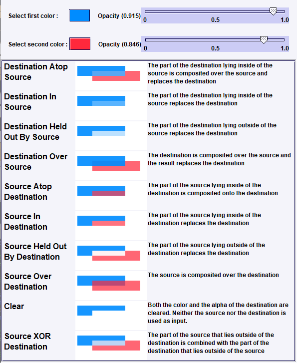

# bb4-color-mixer
Interactive application to help understand how all the [Porter/Duff compositing rules](http://ssp.impulsetrain.com/porterduff.html) work.

## How to run

Use JDK 25+ (`java --version`). With [sdkman](https://sdkman.io/) you can install and switch JDK versions. This repo uses [bb4-gradle](https://github.com/bb4/bb4-gradle) **2.1** and the Gradle **9.8.2** wrapper. `settings.gradle` applies the Foojay toolchain resolver so Gradle can provision a JDK 25 toolchain.

```bash
./gradlew run
```


